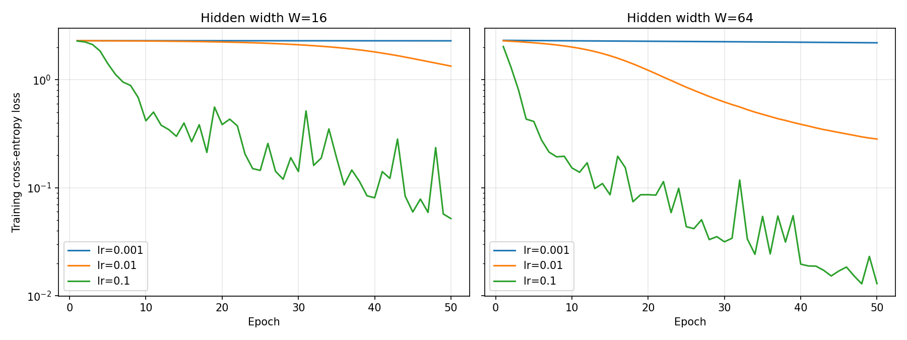

# Lab 2 — Building a Neural Network from Scratch

## 1. Objective

The purpose of this laboratory was to develop a neural network from the ground up with NumPy, check the correctness of its gradients, train the model, and benchmark the execution time of its forward and backward passes.

## 2. Methodology

The `load_digits` dataset was normalized by dividing each pixel value by 16. The class labels were converted into one-hot encoded vectors. The dataset was then divided into training and testing subsets using a 70/30 split and `random_state=42`.

The implemented network consisted of two hidden layers with ReLU activation functions and a softmax output layer. Two hidden-layer sizes were evaluated: W = 16 and W = 64. The initialization notation N(0, 0.01) was treated as specifying a variance of 0.01, which corresponds to a standard deviation of 0.1.

## 3. Results

### Number of parameters

| W | W1 | W2 | W3 | Total |
|---:|---|---|---|---:|
| 16 | (64,16) | (16,16) | (16,10) | 1482 |
| 64 | (64,64) | (64,64) | (64,10) | 8970 |

### Forward propagation and loss

For both network configurations, the output dimensions were (32,10). The largest deviation of the row sums from 1 was 2.22e-16. The initial loss values were 2.2988 for W=16 and 2.3158 for W=64. Both values were close to ln(10) = 2.3026.

### Backpropagation and gradient verification

The gradient at the output layer was obtained using `dz3 = (probs - Y) / N`. It was then propagated through the network layers by applying the chain rule. For the ReLU activation, the derivative equals 1 when the input is positive and 0 otherwise.

The numerical gradient verification succeeded for **all 10 tested weights (10/10)**, and the maximum relative error was 5.99e-07. One of the tested weights had a particularly small gradient of 5.9e-6, so its relative error was more affected by numerical noise. Nevertheless, it stayed within the specified tolerance.

| Parameter | Analytical gradient | Numerical gradient | Relative error | Status |
|---|---:|---:|---:|---|
| W1 (43, 9) | -1.477230e-03 | -1.477230e-03 | 5.71e-09 | OK |
| W1 (58, 3) | -1.349915e-03 | -1.349915e-03 | 6.73e-09 | OK |
| W1 (22, 12) | 5.093874e-04 | 5.093874e-04 | 5.23e-09 | OK |
| W1 (50, 13) | 1.335881e-03 | 1.335881e-03 | 2.97e-09 | OK |
| W3 (14, 0) | 1.088817e-03 | 1.088817e-03 | 1.76e-09 | OK |
| W1 (52, 12) | -5.337228e-03 | -5.337228e-03 | 1.94e-09 | OK |
| W1 (26, 11) | 5.875574e-06 | 5.875567e-06 | 5.99e-07 | OK |
| W3 (11, 2) | 4.663118e-03 | 4.663118e-03 | 1.89e-09 | OK |
| W3 (12, 2) | 3.137707e-03 | 3.137707e-03 | 1.71e-09 | OK |
| W1 (10, 0) | -2.649670e-03 | -2.649670e-03 | 2.65e-09 | OK |

**Successful checks:** 10/10 (minimum required: 9) — PASS

### Model training performance

| W | Learning rate | Final loss | Test accuracy |
|---:|---:|---:|---:|
| 16 | 0.001 | 2.2918 | 0.1315 |
| 16 | 0.01 | 1.3362 | 0.5648 |
| 16 | 0.1 | 0.0518 | 0.9407 |
| 64 | 0.001 | 2.1972 | 0.3741 |
| 64 | 0.01 | 0.2824 | 0.9148 |
| 64 | 0.1 | 0.0130 | 0.9630 |

### Execution time measurements

The batch size was set to 32, and the reported values represent the median of 100 measurements.

| W | Forward pass (µs) | Backward pass (µs) | B/F ratio |
|---:|---:|---:|---:|
| 16 | 42.2 | 43.4 | 1.03 |
| 64 | 88.6 | 111.4 | 1.26 |

## 4. Conclusions

**Training performance:** The strongest result was obtained with W=64 and a learning rate of 0.1. This configuration reached a final loss of 0.0130 and a test accuracy of 96.30%. With a learning rate of 0.001, the model learned much more slowly. In the W=16 experiment with a learning rate of 0.1, the loss varied between epochs due to noise from mini-batch updates.

**Gradient verification:** Gradient checking validates the analytical gradients by comparing them with estimates calculated using finite differences. This procedure is useful for finding backpropagation implementation mistakes before starting model training. Every one of the 10 tested gradients passed the check.

**Execution time:** The forward pass consists of three matrix multiplications, whereas the backward pass requires five. With W=16, both operations took nearly the same amount of time, partly because of NumPy overhead. At W=64, the backward pass required proportionally more time, causing the B/F ratio to rise from 1.03 to 1.26.
