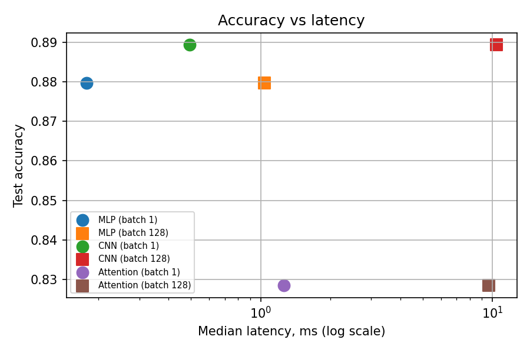
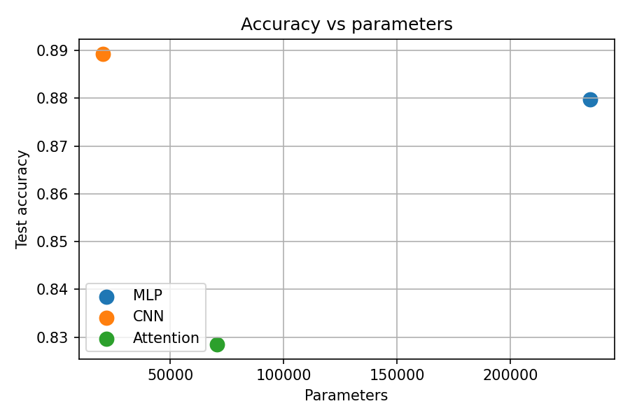

# Lab 3 — Neural Network Architectures and Their Computational Costs

## 1. Objective

The purpose of this laboratory was to evaluate and compare three neural network architectures in terms of parameter count, computational complexity (FLOPs), execution speed, and test accuracy.

## 2. Experimental Setup

The original training set of 60,000 images was divided into 55,000 training samples and 5,000 validation samples. In addition, the official test set containing 10,000 images was used. The batch size was set to 128.

Each model was trained for five epochs using the Adam optimizer with a learning rate of 0.001. All experiments were performed on a CPU.

## 3. Evaluated Models

Three different architectures were implemented:

- **MLP:** a network consisting of three fully connected layers.
- **CNN:** an architecture with two convolutional layers followed by one fully connected layer.
- **Attention:** a model that processes image patches using two Transformer encoder layers and a final classification layer.

## 4. Parameter Counts and FLOPs

| Model | Number of Parameters | Manually Calculated FLOPs | THOP FLOPs |
|---|---:|---:|---:|
| MLP | 235,146 | 469,504 | 469,504 |
| CNN | 20,490 | 2,063,488 | 2,063,488 |
| Attention | 70,794 | 2,329,856 | 101,632 |

For the MLP and CNN architectures, the manually calculated FLOPs are consistent with the values reported by THOP. However, the Attention model shows a significant difference between the two measurements. This may be due to THOP not accounting for every operation performed within the Transformer layers.

Not all implemented models meet the parameter-count range of 100,000–150,000 specified in the assignment. The architectures were retained as described in the provided instructions.

## 5. Inference Performance

| Model | Batch Size 1 (ms) | Batch Size 128 (ms) |
|---|---:|---:|
| MLP | 0.178 | 1.040 |
| CNN | 0.494 | 10.391 |
| Attention | 1.259 | 9.633 |

When processing a single image, the MLP achieved the shortest inference time. In contrast, the Attention architecture required the most time for a single-image prediction.

## 6. Test Accuracy

| Model | Test Accuracy |
|---|---:|
| MLP | 87.97% |
| CNN | 88.93% |
| Attention | 82.85% |

The CNN achieved the best classification accuracy among the three models. The MLP produced a similar result while offering the lowest latency when processing one image. The Attention model recorded the lowest accuracy in this experiment.

## 7. Plots and Manual Calculations

Manual calculations for selected representative layers are available in the results directory.

## 8. Conclusion

The CNN delivered the highest test accuracy, although its inference time was longer when processing a batch of 128 images. The MLP provided the fastest prediction for a single image while maintaining a competitive accuracy score. In this experiment, the Attention model required more computation and achieved a lower accuracy than the other architectures.

Overall, the results demonstrate that the number of model parameters alone is not sufficient to predict its execution speed.
