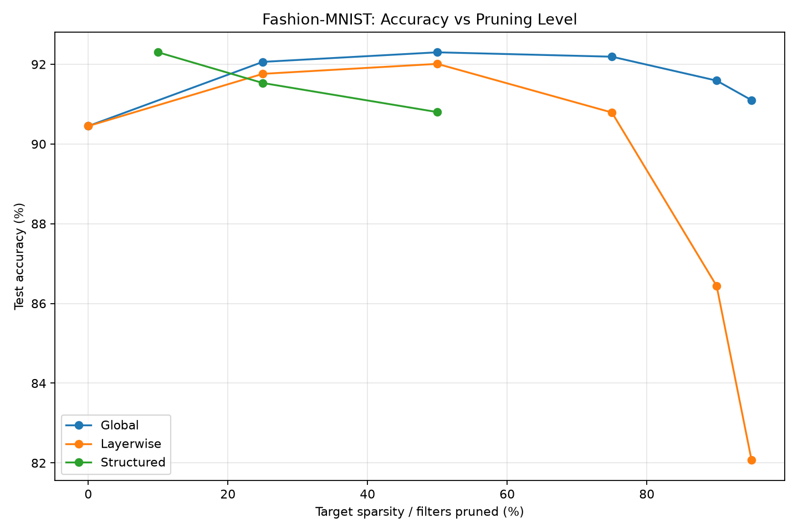
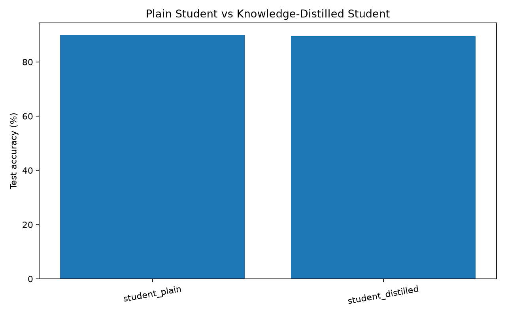

# Lab 7 — Neural Network Compression
## Pruning and Knowledge Distillation

### 1. Project Overview

This project investigates neural network compression techniques using
the Fashion-MNIST dataset. The experiments compare an oversized baseline
CNN, different pruning strategies, and knowledge distillation.

The main objectives are:
- Evaluate an oversized baseline CNN.
- Apply global and layer-wise magnitude pruning.
- Apply structured filter pruning using L2 norms.
- Compare model accuracy, parameter count, file size, and inference latency.
- Train a compact student CNN with and without knowledge distillation.
- Discuss efficiency in terms of data, model, compute, and energy.

### 2. Dataset

Fashion-MNIST was used for all experiments.

| Property | Value |
|---|---:|
| Training images | 60,000 |
| Test images | 10,000 |
| Classes | 10 |
| Image dimensions | 28 x 28 |
| Channels | 1 |

### 3. Experimental Environment

- Framework: PyTorch
- Language: Python
- Device: Apple Silicon MPS
- Dataset: Fashion-MNIST
- Batch size: 128
- Baseline training: 5 epochs
- Pruning fine-tuning: 3 epochs
- Student training: 8 epochs

### 4. Baseline Model

The baseline is an oversized convolutional neural network used as
the reference model and as the teacher for knowledge distillation.

| Metric | Result |
|---|---:|
| Parameters | 1,015,338 |
| Test accuracy | 90.45% |
| Checkpoint size | 3.882 MB |
| Inference latency | 0.197 ms/image |

### 5. Pruning Experiments

Three pruning strategies were investigated.

#### 5.1 Global Magnitude Pruning

The smallest weights across all eligible convolutional and linear
layers were removed according to their absolute magnitude.

| Target sparsity | Actual sparsity | Accuracy |
|---:|---:|---:|
| 0% | 0% | 90.45% |
| 25% | 25% | 92.06% |
| 50% | 50% | 92.30% |
| 75% | 75% | 92.19% |
| 90% | 90% | 91.59% |
| 95% | 95% | 91.10% |

The best result was obtained at 50% sparsity, with 92.30% accuracy.

#### 5.2 Layer-wise Magnitude Pruning

Each eligible layer was pruned independently.

| Target sparsity | Actual sparsity | Accuracy |
|---:|---:|---:|
| 0% | 0% | 90.45% |
| 25% | 25% | 91.76% |
| 50% | 50% | 92.01% |
| 75% | 75% | 90.79% |
| 90% | 90% | 86.44% |
| 95% | 95% | 82.07% |

Layer-wise pruning showed a larger accuracy degradation at high
sparsity levels compared with global pruning.

#### 5.3 Structured Filter Pruning

Structured pruning removed complete convolutional output filters
according to their L2 norm. The corresponding BatchNorm channels
were also masked.

| Target filter sparsity | Actual zero filters | Accuracy |
|---:|---:|---:|
| 10% | 9.82% | 92.30% |
| 25% | 25.00% | 91.53% |
| 50% | 50.00% | 90.80% |

Important implementation note: filters are zeroed using masks.
They are not physically removed from the network architecture.
Therefore, the parameter count and checkpoint size remain unchanged.

### 6. Pruning Efficiency Measurements

| Method | Sparsity | Accuracy | Size (MB) | Latency (ms/image) |
|---|---:|---:|---:|---:|
| Global | 0% | 90.45% | 3.883 | 0.191 |
| Global | 25% | 92.06% | 3.883 | 0.200 |
| Global | 50% | 92.30% | 3.883 | 0.200 |
| Global | 75% | 92.19% | 3.883 | 0.201 |
| Global | 90% | 91.59% | 3.883 | 0.201 |
| Global | 95% | 91.10% | 3.883 | 0.200 |
| Layer-wise | 25% | 91.76% | 3.883 | 0.200 |
| Layer-wise | 50% | 92.01% | 3.883 | 0.196 |
| Layer-wise | 75% | 90.79% | 3.883 | 0.205 |
| Layer-wise | 90% | 86.44% | 3.883 | 0.202 |
| Layer-wise | 95% | 82.07% | 3.883 | 0.197 |
| Structured | 10% | 92.30% | 3.883 | 0.201 |
| Structured | 25% | 91.53% | 3.883 | 0.195 |
| Structured | 50% | 90.80% | 3.883 | 0.195 |

The measurements show that unstructured sparsity does not automatically
improve inference latency when using standard dense operations.
The zero weights remain stored in dense tensors, so checkpoint sizes
also remain almost unchanged.

### 7. Knowledge Distillation

A compact Student CNN was trained in two ways:
1. Standard supervised training.
2. Knowledge distillation using the baseline CNN as the teacher.

Distillation configuration:
- Temperature (T): 4
- Alpha: 0.5
- Student training: 8 epochs

| Metric | Plain Student | Distilled Student |
|---|---:|---:|
| Parameters | 87,210 | 87,210 |
| Accuracy | 89.95% | 89.56% |
| Size (MB) | 0.341 | 0.341 |
| Latency (ms/image) | 0.196 | 0.196 |

The student model contains approximately 11.6 times fewer parameters
than the baseline model.

In this experiment, standard student training achieved slightly higher
accuracy than knowledge distillation. The difference was 0.39
percentage points.

Knowledge distillation did not improve the final accuracy in this
particular experiment, but it provided a comparison between the two
training approaches.

### 8. Efficiency Analysis

#### Data
Fashion-MNIST provides a consistent dataset for comparing all models.
All experiments use the same training and test dataset.

#### Model
Global pruning achieved the highest accuracy among the pruning
experiments: 92.30% at 50% weight sparsity.

The Student CNN reduced the parameter count from 1,015,338 to 87,210.

#### Compute
Inference latency was measured with batch size 1 on Apple Silicon MPS.

Unstructured pruning did not provide a measurable speed improvement
because the models retained their original dense tensor dimensions.

The compact Student CNN achieved approximately 0.196 ms per image.

#### Energy
Direct energy consumption was not measured during the experiments.
No energy values are estimated or fabricated.

Energy efficiency is discussed qualitatively. Smaller models may
reduce computational requirements, but actual energy savings depend
on hardware, execution kernels, and workload.

### 9. Visual Results

#### Accuracy vs. Sparsity



#### Student Accuracy Comparison



### 10. Conclusion

The experiments demonstrate that neural network compression involves
trade-offs between accuracy, model size, sparsity, and inference speed.

Global magnitude pruning achieved 92.30% accuracy at 50% sparsity,
outperforming the baseline accuracy of 90.45%.

Layer-wise pruning showed greater accuracy degradation at high
sparsity levels.

Structured pruning successfully zeroed complete convolutional
filters, although the current implementation uses masks rather than
physically removing filters from the architecture.

The Student CNN reduced the parameter count by approximately 11.6
times while retaining 89.95% accuracy.

Knowledge distillation achieved 89.56% accuracy, slightly below the
plain student model in this experiment.

Overall, the results show that reducing the number of non-zero weights
does not necessarily reduce inference latency or checkpoint size.
Efficient deployment requires considering the model architecture
and hardware support in addition to sparsity.

### 11. Project Structure

```text
Lab7/
├── baseline.py
├── config.py
├── dataset.py
├── distillation.py
├── final_report.py
├── main.py
├── models.py
├── plot_results.py
├── pruning.py
├── utils.py
├── requirements.txt
├── README.md
└── results/
    ├── accuracy_vs_sparsity.png
    ├── student_accuracy_comparison.png
    ├── baseline_metrics.json
    ├── pruning_results.csv
    ├── distillation_results.csv
    ├── final_comparison_table.csv
    └── checkpoints/

```

### 12. Running the Project

Install dependencies:

```bash
pip install -r requirements.txt
```

Run the baseline:

```bash
python main.py --stage baseline
```

Run pruning:

```bash
python main.py --stage pruning
```

Run knowledge distillation:

```bash
python main.py --stage distillation
```

Generate plots:

```bash
python plot_results.py
```

Generate the final comparison table:

```bash
python final_report.py
```
